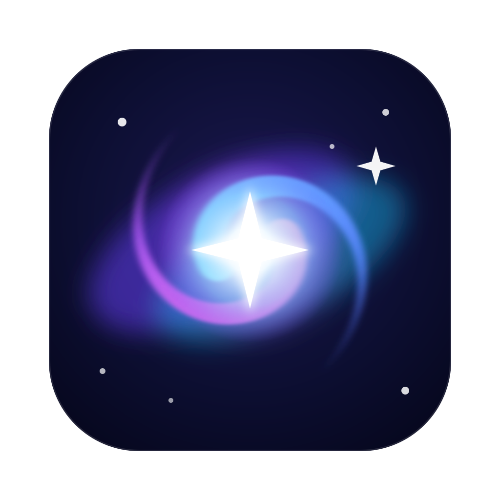

<p align="center">
  
</p>

<h1 align="center">T3 Nebula</h1>

<p align="center">
  <strong>A Windows-first community build of T3 Code, the open-source GUI for coding agents.</strong><br />
  Upstream T3 Code + the T3 Stardust feature set + a few things of its own.
</p>

<p align="center">
  <a href="README.zh-CN.md"><strong>简体中文</strong></a> ·
  <a href="#credits">Credits</a> ·
  <a href="#whats-new">What's new</a> ·
  <a href="#build">Build on Windows</a> ·
  <a href="#providers">Providers</a> ·
  <a href="#notes">Notes</a>
</p>

<p align="center">
  
  
  
</p>

---

T3 Nebula is a personal fork that runs your existing agent subscriptions (Codex, Claude, Antigravity,
Cursor, OpenCode, DeepSeek Harness and other ACP agents) in one desktop app. It starts from
**T3 Stardust**, a heavily customized T3 Code with a full Chinese UI and usage analytics, merges in
the latest **official T3 Code**, and adds the pieces needed to build and use it comfortably on Windows.

The interface follows your system language. English and Simplified Chinese are both complete.

<a id="credits"></a>

## Credits

T3 Nebula stands on three projects. All credit for their work goes to their authors.

| Project                                                                                       | What T3 Nebula takes from it                                                                                                                                                                                                                                                                                                            |
| --------------------------------------------------------------------------------------------- | --------------------------------------------------------------------------------------------------------------------------------------------------------------------------------------------------------------------------------------------------------------------------------------------------------------------------------------- |
| [**pingdotgg/t3code**](https://github.com/pingdotgg/t3code)                                   | The foundation: the app, server, providers, orchestration and checkpoints. Merged up to late November 2026. The official README is kept in [README.upstream.md](README.upstream.md).                                                                                                                                                    |
| [**zds-xiaoxin/xiaoxin-t3code**](https://github.com/zds-xiaoxin/xiaoxin-t3code) (T3 Stardust) | The base of this fork: Chinese UI for every custom feature, the Composer V9 model capsule, the Starship reasoning-effort slider, session and token popovers, the topbar quota capsule, multi-account quota rings and burn-down forecasts, the four-tab usage workbench, task step cards, preview pin annotations and the artifact wall. |
| [**Leobai03/t3code-quota-ui**](https://github.com/Leobai03/t3code-quota-ui)                   | The idea behind the cost currency switch. Its other quota features (topbar quota pills, model-picker quota badges, burn forecast) already exist in Stardust, so only the CNY/USD switch was ported.                                                                                                                                     |

T3 Nebula is an independent community project. It is not affiliated with T3 Tools or with the
T3 Stardust maintainers.

<a id="whats-new"></a>

## What's new in T3 Nebula

Compared with T3 Stardust, T3 Nebula adds or changes the following:

| Area                                    | Change                                                                                                                                                                                                                                                                                                                                                             |
| --------------------------------------- | ------------------------------------------------------------------------------------------------------------------------------------------------------------------------------------------------------------------------------------------------------------------------------------------------------------------------------------------------------------------ |
| **Upstream**                            | The latest official T3 Code is merged into Stardust, with the conflicts resolved by hand.                                                                                                                                                                                                                                                                          |
| **Cost currency**                       | The Usage page shows costs in US dollars or Chinese yuan. The exchange rate is editable and remembered, and chart axes round in the selected currency.                                                                                                                                                                                                             |
| **Live output speed**                   | While a turn runs, the stats bar under the composer shows its output rate in tokens per second, alongside the round, status and elapsed time.                                                                                                                                                                                                                      |
| **npm-installed ACP agents on Windows** | Local ACP commands installed with `npm install -g` work by name. T3 Nebula reads npm's `.cmd` wrapper and launches the program it starts, still without a shell.                                                                                                                                                                                                   |
| **DeepSeek Harness**                    | The desktop app's bundled CLI is recognized, so provider status checks no longer leave empty sessions in your DeepSeek history.                                                                                                                                                                                                                                    |
| **Privacy defaults**                    | Anonymous usage data for the upstream T3 Code project stays off until you turn it on in Settings → About, and the welcome page says so. Stardust's anonymous usage counting (sent to xiaoxin666.cn) and its community update checks against the Stardust repository are removed. The official auto-updater is disabled, so upstream builds never replace this one. |
| **Windows packaging**                   | Builds a working NSIS installer. The payload limit now leaves room for the server bytecode cache, and the Windows `.ico` files carry the app icon.                                                                                                                                                                                                                 |
| **Name and icon**                       | The app is renamed T3 Nebula (T3 星云 in Chinese), with a new spiral-galaxy icon. The source is [assets/nebula-icon.svg](assets/nebula-icon.svg).                                                                                                                                                                                                                  |
| **Sub2API quota**                       | If Claude Code goes through your own Sub2API relay, add it under **Settings → Providers → Add hub → Sub2API** with the relay's admin API key. The Usage page then shows the 5-hour and weekly quota of the Claude accounts behind the relay.                                                                                                                       |
| **Windows polish**                      | Controls that only work against macOS servers (the disk cleanup center, the Cursor Keychain switch) are hidden on Windows, the artifact wall says File Explorer instead of Finder, and `vp run dev` prefers IPv4 for `localhost` on Windows.                                                                                                                       |
| **Code hygiene**                        | Removes files and exports left unused after the merge, so the pre-commit checks pass again.                                                                                                                                                                                                                                                                        |

<a id="build"></a>

## Build on Windows

Prebuilt installers are on the [Releases](https://github.com/whocare0012-wq/t3-nebula/releases) page.
To build one yourself:

**Requirements**

- Node.js 26 (the repository pins 26.13.1)
- [Vite+](https://viteplus.dev) (`vp`)
- Rust (`rustup`) and Visual Studio 2022 Build Tools with the C++ workload, for the native resource monitor

**Run in development**

```powershell
vp i
vp run dev
```

Open the `pairingUrl` printed in the terminal.

**Build the installer**

```powershell
node scripts/build-desktop-artifact.ts --platform win --target nsis --arch x64
```

The installer is written to `release/T3-Nebula-<version>-x64.exe`. It is not code-signed, so Windows
SmartScreen asks for confirmation: choose **More info**, then **Run anyway**.

**Publish a release**

Build with the update feed and a version above the last release, then upload the installer, its
blockmap and `latest.yml`:

```powershell
$env:T3CODE_DESKTOP_UPDATE_REPOSITORY = "whocare0012-wq/t3-nebula"
node scripts/build-desktop-artifact.ts --platform win --target nsis --arch x64 --build-version 1.0.1
gh release create v1.0.1 release/T3-Nebula-1.0.1-x64.exe release/T3-Nebula-1.0.1-x64.exe.blockmap release/latest.yml --title "T3 Nebula 1.0.1"
```

<a id="providers"></a>

## Providers

| Provider             | Setup                                                                                                                                                                                                                                                                                                                                                                                                                                 |
| -------------------- | ------------------------------------------------------------------------------------------------------------------------------------------------------------------------------------------------------------------------------------------------------------------------------------------------------------------------------------------------------------------------------------------------------------------------------------- |
| **Codex**            | No manual install. In **Settings → Providers**, connect with ChatGPT and T3 Nebula installs Codex for you. An existing `codex login` also works.                                                                                                                                                                                                                                                                                      |
| **Antigravity**      | No manual install. Enable it in **Settings → Providers**, install its runtime there, then sign in with Google. Needs about 1.25 GB of free space.                                                                                                                                                                                                                                                                                     |
| **Claude**           | Install Claude Code yourself and run `claude auth login`.                                                                                                                                                                                                                                                                                                                                                                             |
| **DeepSeek Harness** | Add a **Local ACP command**. With the npm CLI, use `dsh` with the arguments `--profile` and `acp`. With the desktop app, point it at `DeepSeek Harness.exe`, pass `--expose-internals`, the app's `resources\app.asar\dsh\node_modules\@deepseek-ai\dsh-desktop-host\lib\cli.js`, `--profile` and `acp`, and set `ELECTRON_RUN_AS_NODE=1`. The official ACP bridge does not report token counts, so cost and speed stay empty for it. |
| **Other ACP agents** | **Settings → Providers → Add provider → Show more** lists the ACP Registry, or lets you add any local ACP command.                                                                                                                                                                                                                                                                                                                    |

<a id="notes"></a>

## Notes

- **Shared data.** T3 Nebula keeps T3 Code's app ID and data directory (`~/.t3`). Your projects and
  threads carry over, but it cannot be installed side by side with official T3 Code.
- **Updates.** Installed builds check this repository's
  [Releases](https://github.com/whocare0012-wq/t3-nebula/releases) and offer new versions in the app.
- **macOS-only features.** Stardust's disk cleanup center and the Cursor Keychain switch only work on macOS servers, so they are hidden on Windows. The Usage page still shows disk usage.
- **Windows test runs.** Some existing upstream and Stardust tests fail on Windows (symlink
  permissions, path assumptions). They fail the same way without this fork's changes.

## License

[MIT](LICENSE), as in upstream T3 Code. Copyright for the original work stays with its authors.
